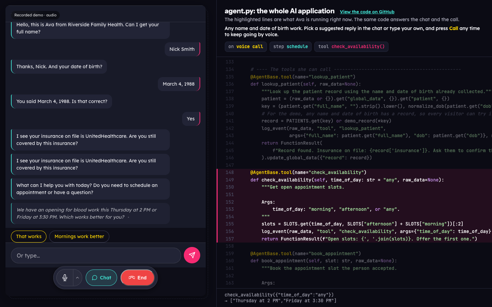

# Healthcare Front Desk

A chat-first AI assistant built on SignalWire. Ava, the front desk for a fictional clinic, answers a
text chat in the browser. Press **Call** at any point and the same agent picks up the conversation by
voice, without asking anything twice. Switch back to text and she still knows what happened on the call.
Beside the chat, the page shows `agent.py` and highlights each step and tool as it runs.

Try it live on [tryit.signalwire.com](https://tryit.signalwire.com/apps/healthcare/).



## What it shows

- **One agent, chat and voice.** The AI Chat service and the browser call fetch the same SWML from
  `/riverside`. There is no second prompt to keep in sync.
- **The switch keeps the thread.** The SDK's `ChatGateway` and `HandoffRouter` move the conversation
  between chat and call. Each new leg gets the earlier transcript and starts at the right step.
- **Code, not prompts.** Ava follows five steps defined in code (`intake`, `verify`, `reason`,
  `schedule`, `wrap_up`). The patient record, the booking and the summary come from code, so the model
  cannot double-book or invent a patient.
- **Any name works.** For the demo, any name and date of birth gets a stable made-up record. The page
  has tap-to-send buttons for the details, which also reach Ava during a call (type-to-talk).

All patient data is fictional.

## Files

| File | What it is |
|---|---|
| `agent.py` | The whole AI application: Ava's prompt, five steps, three tools, the summary. No hosting code. |
| `app.py` | Hosting: the chat gateway and handoff routes, the call token, the Call Fabric handler, the code panel feed. |
| `web/index.html` | The page: `@signalwire/address-widget` 0.4.1 (vendored) on the left, live code on the right. |
| `e2e_test.py` | Unattended browser test: chat, call, typed turns on the call, back to chat (16 checks). |

## Run it

1. Copy `.env.example` to `.env` and fill in your space, project ID and API token. The token needs the
   **AI Chat** scope.
2. Expose the app on a public HTTPS URL (for local work, a tunnel such as
   `cloudflared tunnel --url http://localhost:3000`) and put that URL in `SWML_PROXY_URL_BASE`.
3. Install and start:

   ```bash
   python -m venv .venv && . .venv/bin/activate
   pip install -r requirements.txt
   python app.py
   ```

4. Open `SWML_PROXY_URL_BASE` in Chrome. On startup the app creates (or updates) a Call Fabric SWML
   handler named `healthcare-front-desk` that points at `/riverside`, and the page dials its address.

Run exactly one process: conversations, handoffs and rate limits live in memory.

## Deploy

`Procfile` and `app.json` follow the signalwire-demos layout (Dokku or Heroku style). Set the same
environment variables, with `SWML_PROXY_URL_BASE` as the deployed URL, and keep one worker.

## Safeguards

- Calls stop at 300 seconds (`hard_stop_time`), and the page hangs up after 5 minutes.
- The SWML, tool and summary endpoints use the SDK's basic auth. The credentials travel only in the
  URLs SignalWire calls.
- New chats are capped per minute and turns per conversation; call tokens are minted only when **Call**
  is pressed and capped per IP per hour.

## Widget notes

`web/index.html` patches a few behaviours of `@signalwire/address-widget` 0.4.1. Each patch is commented
in the page. Re-check them if you upgrade the widget:

- With `defaultMode: 'chat'`, **Call** reopened chat instead of dialing.
- The consent dialog pre-checked "help train AI features".
- After switching back to text, a late call "disconnected" event closed the panel.
- The panel opened as a modal dialog, which blocked the rest of the page.
- A chat message sent while Ava was still replying was dropped.

## Test

```bash
pip install playwright
python e2e_test.py https://your-app.example.com docs/screenshots
```

It drives your installed Chrome with a fake microphone. Voice turns go in through type-to-talk, so a
spoken-voice pass still needs a person.
